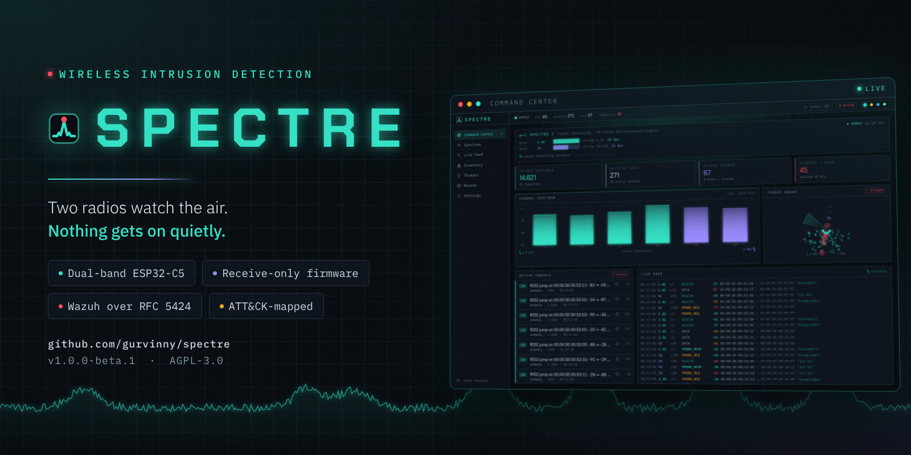

<h1>GURVIN SINGH</h1>

  
  

<i>I build security tools end-to-end — from receive-only radio firmware to the alert in the SIEM.</i>

---

<b>// FEATURED PROJECT</b>

### SPECTRE — Wireless Intrusion Detection

  Dual-band <b>ESP32-C5</b> sensors running custom receive-only firmware stream 802.11 frames over native USB 
  to a Python detection engine (deauth flood, evil twin, beacon/probe flood, RSSI anomaly). 
  Scored threats route to <b>Wazuh over RFC 5424</b> and a Next.js SOC console — 3 of 4 rules mapped to <b>MITRE ATT&amp;CK</b>.

  
  
  
  
  
  
  

---

<b>// FOCUS &amp; STACK</b>

| Domain | Core Stack &amp; Protocols |
| :--- | :--- |
| **RF &amp; Sensors** | ESP32-C5 · 802.11 Telemetry · Native USB · Receive-Only Firmware |
| **Detection &amp; SIEM** | Wazuh SIEM/XDR · RFC 5424 · Sigma · YARA · MITRE ATT&amp;CK · CIS Hardening |
| **Zero-Trust Infra** | Proxmox VE · pfSense Plus · VLAN Segmentation · WireGuard · Authentik FIDO2 · Internal PKI |
| **Security Tooling** | Python · FastAPI · TypeScript · Next.js · Playwright QA · CodeQL |

---

<b>// CREDENTIALS</b>

<b>B.S. Cybersecurity &amp; Information Assurance</b> · Western Governors University · <code>Expected 02/2027</code>

  
  
  
  
  
  

---

  Security concerns: see the <a href="https://github.com/gurvinny/.github/blob/main/SECURITY.md">security policy</a> · Issues are disabled on this repository.

